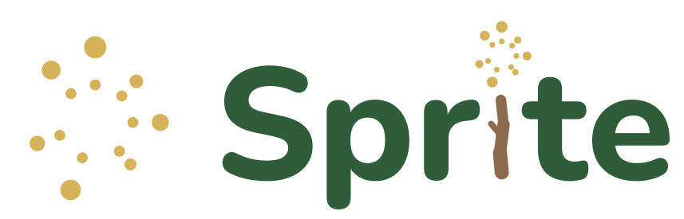

<p align="center">
  <picture>
    <source media="(prefers-color-scheme: dark)" srcset="assets/logo/lockup-dark.svg">
    
  </picture>
</p>

**Sprite brings the Curry language to Python.** [Curry](https://www.curry-lang.org/)
is a functional logic language. It has the strongly typed functions and the
lazy evaluation of Haskell, and it adds two ideas from logic programming to
the language itself: a function may have several results, and a value may be
left unknown for the program to find.

Sprite compiles Curry modules to native code by way of C++ and runs them in
its own runtime, and its Python API imports a Curry module like a Python
module. Underneath is the Fair Scheme, an evaluation strategy that has been
proved correct and complete: a computation finds every value of an
expression and nothing else, in whatever order the alternatives are
explored. The strategy and its proofs are written up in a
[dissertation](https://andrewjost.wordpress.com/wp-content/uploads/2023/05/jostthesis.final_.10may23.pdf)
and a shorter
[paper](http://web.cecs.pdx.edu/~antoy/homepage/publications/lopstr13/long.pdf).

## Curry from Python

With Sprite, Curry code is a module that Python imports. The functions live
in a Curry file, with their types:

```curry
-- Hello.curry
greet :: String -> String
greet name = "Hello, " ++ name ++ "!"
```

Python imports the module directly. The first import translates it and
compiles it to native code in the background; every later import reuses
the result.

```python
import curry
curry.path.insert(0, '.')      # the directories where Curry modules are found
from curry.lib import Hello

goal = Hello.greet('World')    # a Curry expression, typed from the signature
results = curry.eval(goal)     # evaluate it
results.one()                  # take its one value
# 'Hello, World!'
```

A Curry expression has any number of values, zero or more. `curry.eval`
returns all of them, and `.one()` takes the first; here there is exactly
one. Python values are converted both ways by the Curry types: a Python
string goes in, and a Python string comes out.

## Logic programming, from Python

Python needs little new to use the logic side of Curry: a function with
several results is iterated like any sequence, and an unknown is a value
that Python creates and hands in.

**Several results.** `perm` returns a permutation of a list, any of them:
the two rules of `insert` overlap, and Curry takes both. Python sees every
result:

```curry
perm :: [a] -> [a]
perm []     = []
perm (x:xs) = insert (perm xs)
 where insert ys     = x : ys
       insert (y:ys) = y : insert ys
```

```python
list(curry.eval(Hello.perm([1, 2, 3])))
# [[1, 2, 3], [2, 1, 3], [1, 3, 2], [3, 1, 2], [2, 3, 1], [3, 2, 1]]
```

**Patterns that describe a shape.** A functional pattern matches a list that
ends in `x`, whatever comes before it:

```curry
last :: [Int] -> Int
last (_ ++ [x]) = x
```

```python
curry.eval(Hello.last([1, 2, 3])).one()
# 3
```

**Unknowns.** Three switches light a lamp when exactly two of them are up.
`lit` returns the positions of the switches when the lamp is on. Hand it
unknowns, and Curry finds every setting that lights the lamp:

```curry
lampOn :: Bool -> Bool -> Bool -> Bool
lampOn True  True  False = True
lampOn True  False True  = True
lampOn False True  True  = True

lit :: Bool -> Bool -> Bool -> (Bool, Bool, Bool)
lit a b c | lampOn a b c = (a, b, c)
```

```python
a, b, c = curry.free(), curry.free(), curry.free()
for setting in curry.eval(Hello.lit(a, b, c)):
    print(setting)
# (False, True, True)
# (True, False, True)
# (True, True, False)
```

Fix the first switch up, `Hello.lit(True, b, c)`, and two settings remain.
The same ideas carry real programs: the [examples](examples/README) include
a sudoku solver, cryptarithms, n-queens, a regular-expression matcher and a
parser built from functional patterns. The
[Quickstart](https://andyjost.github.io/Sprite/Quickstart.html) continues
from here.

## Installation

```sh
pip install curry
```

Sprite supports Python 3.11 to 3.15 on Linux (x86-64 and aarch64) and on
macOS 15 or newer (Apple silicon and Intel). The wheels include the compiled
Curry library, and pip installs the Curry front end beside them (the package
`curry-frontend`). A C++ compiler (g++) is optional: without one, new modules
run interpreted.

Without a suitable Python, let the installer bring its own. It installs
[uv](https://docs.astral.sh/uv/), a managed Python and Sprite under your home
directory, and it never uses sudo:

```sh
curl -LsSf https://raw.githubusercontent.com/andyjost/Sprite/master/getsprite | sh
```

The [Installation Guide](https://andyjost.github.io/Sprite/Installation/Installation.html)
covers the options of the installer, building from source and running without
a C++ compiler. `python -m curry` opens the Curry REPL, and
`python -m curry Program.curry` runs a program.

## Learn more

- [Quickstart](https://andyjost.github.io/Sprite/Quickstart.html): five minutes with the Python API.
- [Examples](https://andyjost.github.io/Sprite/Examples.html): twenty-six runnable programs, from a first Curry program to applications.
- [The Python Interface](https://andyjost.github.io/Sprite/PythonAPI/index.html): terms, evaluation, answers and bindings, set functions and streams.
- [The REPL](https://andyjost.github.io/Sprite/REPL.html) and the [command-line tools](https://andyjost.github.io/Sprite/CommandLineInterface/index.html).
- [Curry Primer](https://andyjost.github.io/Sprite/CurryPrimer/index.html): the language for a Python programmer.
- [API Reference](https://andyjost.github.io/Sprite/Reference/index.html).

**For Curry researchers.** Sprite uses the Curry front end of PAKCS and ships
the `base` library of PAKCS 3.10.0, so most programs written for PAKCS run
unchanged, with the same answers in another order. The runtime is a C++ graph
rewriting engine that implements the Fair Scheme with pull-tabbing; set
functions follow the weak encapsulation of the dissertation. The
[Status](https://andyjost.github.io/Sprite/Status.html) page lists what
differs and the known limits, and
[Performance](https://andyjost.github.io/Sprite/Performance.html) holds the
measurements.

## Support

Questions, bug reports and feature requests go to the
[issue tracker](https://github.com/andyjost/Sprite/issues). The best bug
report is a small Curry program or Python snippet with the answer you
expected; `tests/README` shows how to turn it into a unit test. Questions
about the Curry language itself go to the Curry mailing list
(curry@lists.RWTH-Aachen.DE). Sprite is developed and maintained by Andy Jost
(andy.m.jost@gmail.com).

## Contributing

Contributions are welcome; see [CONTRIBUTING.md](CONTRIBUTING.md).

## License

Sprite is distributed under the BSD 3-Clause License; see [LICENSE](LICENSE).
The Curry library under `curry/lib` carries its own BSD license and notice.
