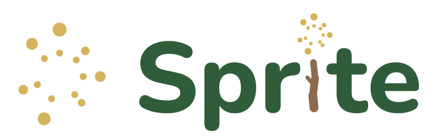

<p align="center">
  <picture>
    <source media="(prefers-color-scheme: dark)" srcset="assets/logo/lockup-dark.svg">
    
  </picture>
</p>

<p align="center">
  <a href="https://pypi.org/project/curry/"></a>
  <a href="https://pypi.org/project/curry/"></a>
  
  <a href="https://github.com/andyjost/Sprite/actions/workflows/ci.yml"></a>
  <a href="LICENSE"></a>
</p>

Sprite is an implementation of the multi-paradigm programming language
[Curry](https://www.curry-lang.org/), embedded in Python. It seamlessly
integrates features of functional programming and logic programming into your
Python project. These features include algebraic data types, pattern matching,
strong typing, type inference, lazy evaluation, nondeterminism, logic
variables, and search. Curry follows Haskell's syntax while adding its own
semantics. Its only dependency is one small package, the Curry front end.

The functional side rests on graph rewriting, the well-studied evaluation model
behind lazy languages such as Haskell. Here, a program is a set of rewrite
rules, applied lazily and only as far as a result demands. For the logic side,
you state what a desired value has to satisfy, leaving search to the runtime.
Many programs then read as their own specification, which keeps them simple,
short, and obviously correct. Sprite's evaluation strategy, the Fair Scheme, is
proved sound, complete, and optimal. This means it computes all and only the
values of any source expression, and every step it takes is one that any
strategy must take.

With Sprite, you don't have to write your whole project in a functional or
logic language, and deal with the integration and distribution issues that
entails. Write the part that is naturally a search or a set of rules as a small
Curry module, then simply import that module. The first import translates the
module and caches the result beside the source, without a C++ compiler.
For speed, the same code compiles to native machine code, either just in time
as the program runs (the `jit` extra) or ahead of time into an object you can
[embed in an
application](https://andyjost.github.io/Sprite/PythonAPI/UsingTheAPI.html).

Sprite is in alpha. Install it with `pip install --pre curry`. Try it and [tell
us what breaks](https://github.com/andyjost/Sprite/issues).

## Getting started

Here is a Curry module for Boolean formulas:

```curry
-- Logic.curry
data Formula = T | F | Not Formula | And Formula Formula | Or Formula Formula

render :: Formula -> String
render T = "T"
render F = "F"
render (Not p) = "!" ++ render p
render (And p q) = "(" ++ render p ++ " & " ++ render q ++ ")"
render (Or p q) = "(" ++ render p ++ " | " ++ render q ++ ")"
```

The module declares a data type, `Formula`, with five constructors, and a
function, `render`, over that type. This Curry snippet is also valid Haskell.
Save it next to your Python code, then import it, construct a formula, and
render it as a string:

```python
import curry
curry.path.insert(0, '.')          # Curry's sys.path
from curry.lib import Logic as L   # compiles and imports ./Logic.curry

formula = L.And(L.Or(L.T, L.F), L.Not(L.F))
goal = L.render(formula)
curry.eval(goal).one()             # the one value: '((T | F) & !F)'
```

The constructors of `Formula` and the `render` function appear as Python
objects. `L.render(formula)` builds an expression without running it;
`curry.eval` evaluates it, and Sprite converts the result to a Python string.

## Nondeterminism

Curry is nondeterministic, which means an expression may have any number of
values. Curry's logic features all derive from this one property. The simplest
example is the choice operator `?` of the Prelude, defined by two overlapping
rules:

```curry
(?) :: a -> a -> a
x ? _ = x
_ ? y = y
```

Both rules apply, so `1 ? 2` has two values, `1` and `2`.

Another logic feature is the *functional pattern*, a pattern that contains a
function call. It matches every argument the call could produce, so a single
rule can describe a search. Sprite finds all the solutions. Here, `split`
generates every way to split a list in two:

```curry
-- Lists.curry
split (xs ++ ys) = (xs, ys)
```

The rule matches each `xs` and `ys` whose concatenation is the argument. To
evaluate the function and iterate through the results in Python, write:

```python
from curry.lib import Lists

for xs, ys in curry.eval(Lists.split([1, 2, 3])):
    print(xs, ys)
# [] [1, 2, 3]
# [1] [2, 3]
# [1, 2] [3]
# [1, 2, 3] []
```

`curry.eval` returns an iterator over the results. Use `one`, as above, when
exactly one result is expected, or `next` to take the first of several values.

## Running a function backwards

A functional pattern can also turn `render` into a parser. Write a call of
`render` as the pattern and leave the formula unknown. That's the whole parser,
one rule added to `Logic.curry`:

```curry
-- Logic.curry, continued
parse :: String -> Formula
parse (render p) = p
```

With the addition of a functional pattern, the module is no longer valid
Haskell. `p` is a logic variable. To match the pattern, Sprite solves for the
formula whose rendering is the given string, and that formula is the answer:

```python
tree = curry.eval(L.parse('((T | F) & !F)')).one()
print(tree)                            # And (Or T F) (Not F)
assert tree == formula
```

The five rules of `render` serve as the grammar. There's no second copy of the
grammar to keep in step, and the parser can't disagree with the printer,
because it is the printer.

## Executable specifications

The same idea scales to larger specifications. When a problem is already
defined by rules, Curry lets you transcribe the rules and run them. The result
is an [executable specification](https://www.michaelhanus.de/papers/PADL12.pdf).
This approach has several benefits:

- **Easy to check:** each rule can be read against the text it came from.
- **Free of mechanical detail:** Sprite does the search, so there are no loops,
  no backtracking, and no bookkeeping.
- **Quick to write:** each rule of the source becomes a rule of the program.
- **Short:** an agent spends fewer tokens writing it, and a person spends less
  time reviewing it.
- **Runnable as written:** it serves as a prototype, or as an oracle for testing
  a later implementation.

For example, an agent translated the C++ standard's rules for standard
conversions and overload ranking into Curry in a few minutes. The result is a
module of about 340 lines ([CxxOverload.curry](examples/cxx/CxxOverload.curry)).
The snippet below is the rule for a null pointer conversion. Compare its
comment, a paraphrase of the C++ standard, with the Curry code beneath it:

```curry
-- A null pointer conversion ([conv.ptr]/1): std::nullptr_t to any pointer
-- or pointer to member.
standard _ a p
  | is_null_pointer a && (is_pointer p || is_member_pointer p)
  = Conversion
```

Here `a` is the argument type, `p` is the parameter type, and the rule applies
when its guard (the condition after `|`) holds. The constructor `Conversion` is
the rank the standard gives this conversion. The other conversions are rules of
the same form.

Because the program is a specification, it can also answer questions it was not
written for. Given the overloads `f(long)`, `f(double)` and `f(int const*)`,
[example 21](examples/21-cxx-types-overloads) asks which argument types make a
call ambiguous. Sprite tries every type up to a small depth and keeps the ones
whose call has no best candidate. Among them is `int`: `f(1)` is ambiguous,
because `int` converts to both `long` and `double` at the same rank. `float` is
not, because it promotes to `double`.

A similar query asks which argument types pick `f(int const*)`. The answers
include `int*`, as expected, but also `int[3]` and `std::nullptr_t`. The array
decays to a pointer and gains `const`, which still counts as an exact match.
`std::nullptr_t` converts to any pointer, but to neither `long` nor `double`.

Other [examples](https://andyjost.github.io/Sprite/Examples.html) include a
[build system](examples/24-build-system) whose pattern rules run both ways and a
[package dependency solver](examples/15-dependency-solver) with no search code.

## Installation

```sh
pip install --pre curry
```

The `--pre` flag is needed while Sprite is in alpha. For faster code, add the
`jit` extra (it needs a platform that llvmlite supports):

```sh
pip install --pre "curry[jit]"
```

To install without touching your own Python, use the installer script. It brings
its own Python and installs Sprite under your home directory:

```sh
curl -LsSf https://raw.githubusercontent.com/andyjost/Sprite/master/getsprite | sh
```

## Documentation

The [documentation](https://andyjost.github.io/Sprite/) has a
[Quickstart](https://andyjost.github.io/Sprite/Quickstart.html), a
[Curry primer](https://andyjost.github.io/Sprite/CurryPrimer/index.html) for
Python programmers, the [Python API](https://andyjost.github.io/Sprite/PythonAPI/index.html),
the [REPL](https://andyjost.github.io/Sprite/REPL.html), and a
[Status](https://andyjost.github.io/Sprite/Status.html) page that says what
works today. Each of the twenty-six
[examples](https://andyjost.github.io/Sprite/Examples.html) has a README, a run
script, and recorded output. The Fair Scheme and its proofs are written up in a
[dissertation](https://doi.org/10.15760/etd.3564)
and a shorter [paper](https://web.cecs.pdx.edu/~antoy/homepage/publications/lopstr13/long.pdf).

## Contributing

Bug reports with a reproducer are the most useful contribution right now;
please file them on the [issue tracker](https://github.com/andyjost/Sprite/issues).
The runtime follows a proved strategy, so a change to the runtime is a change to
the proof. For that reason we discuss changes before they are written and don't
take unsolicited pull requests. If you want to work on something, open an issue
first and we'll talk. [CONTRIBUTING.md](CONTRIBUTING.md) has the setup and the
conventions.

## License

[BSD 3-Clause](LICENSE). The Curry library under `curry/lib` is the base
library of PAKCS and carries its license and a notice of its origin.
